# American Option Pricing: Binomial Trees, Longstaff-Schwartz LSMC, ML and RL

This project prices American-style options, which can be exercised at any time up to expiry, and studies how to learn the optimal exercise decision. It includes:

- **Binomial trees** (Cox-Ross-Rubinstein, plus the smoothed and extrapolated BBSR variant) as exact benchmarks.
- **Least-Squares Monte Carlo (LSMC)** following Longstaff & Schwartz (2001), simulating thousands of risk-neutral price paths.
- **Machine-learned continuation values** inside LSMC: OLS and ridge regression on five basis-function families, a neural network, and monotone gradient-boosted trees.
- **Reinforcement learning** for the exercise policy: Least-Squares Policy Iteration (LSPI) and Fitted Q-Iteration (FQI).
- **Studies** of basis functions, regression specifications, path counts, exercise-date grids and variance reduction, plus **sensitivity and scenario analyses** of prices, Greeks and the optimal exercise boundary.

Everything is reproducible with one command, `python -m amerop.experiments` (about 4 minutes on a laptop). It writes every table to `results/` and every chart to `figures/`.

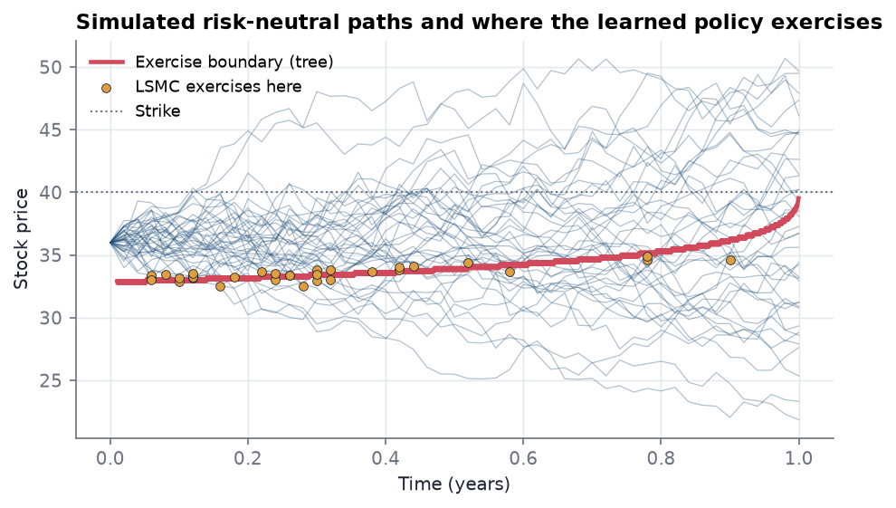

---

## What the project does

| Goal | Where | Result |
|---|---|---|
| American option pricing with binomial trees and Longstaff-Schwartz LSMC | `amerop/binomial.py`, `amerop/longstaff_schwartz.py` | LSMC is within 2 standard errors of the exact Bermudan price in **20 of 20** benchmark cases (mean absolute error **0.53¢**) |
| Regression- and RL-based estimates of continuation values and early-exercise decisions | `amerop/longstaff_schwartz.py` (OLS, ridge, MLP, gradient boosting), `amerop/rl.py` (LSPI, FQI) | Six estimators compared on policy quality out of sample and on training time |
| Thousands of risk-neutral paths to model the asset and test pricing accuracy | `amerop/models.py` | Up to 100,000 paths × 200 dates, with error tracked against exact tree prices from 1,000 to 100,000 paths |
| Basis functions, regression specifications and simulation parameters vs estimation error | `experiments.basis_study`, `lsmc_convergence`, `exercise_date_study`, `variance_reduction` | 5 basis families × 6 degrees × 3 regression specs, 7 path counts, 6 exercise grids, 7 variance-reduction setups |
| Sensitivity and scenario analysis across volatility, rates, maturity and strike | `experiments.sensitivity` | One-factor sweeps, 10 stress scenarios, exercise boundaries per scenario, heatmaps of premium and critical price, Greeks |

---

## Methods

### The contract and the market model

A put with strike K on a stock following risk-neutral geometric Brownian motion:

dS = (r − q) S dt + σ S dW

The paths are simulated exactly in log space. The baseline is the classic Longstaff-Schwartz test case: S₀ = 36, K = 40, r = 6%, σ = 20%, T = 1 year.

### Binomial trees (`binomial.py`)

- **CRR** (Cox, Ross & Rubinstein 1979): u = e^{σ√Δt}, d = 1/u, risk-neutral probability p = (e^{(r−q)Δt} − d)/(u − d). Backward induction takes V = max(continuation, exercise) at every node. The tree also records the **critical price S\*(t)** and the delta, gamma and theta.
- **BBSR** (Broadie & Detemple 1996): uses the Black-Scholes value at the last step, which removes CRR's odd/even oscillation, then Richardson extrapolation 2·P(n) − P(n/2). This is the American benchmark. It agrees with a 4,000-step CRR tree to 0.001.
- **Bermudan tree**: the same tree, with exercise allowed only on LSMC's grid of dates. LSMC with 50 dates prices a *Bermudan* option, so this tree gives it an exact like-for-like target. That separates discretisation error from regression error.

### Least-Squares Monte Carlo (`longstaff_schwartz.py`)

Working backward from expiry, at each exercise date:

1. Take the paths that are in the money. Their discounted realised future cash flow is the regression target.
2. Fit a **continuation-value** estimate Ĉ(t, S).
3. Exercise wherever the payoff exceeds Ĉ. Those paths' cash flows become the payoff at t.

The price is the average discounted cash flow under the resulting policy. Because the same paths both fit and price the policy, the **in-sample** estimate carries some foresight. `evaluate_policy` therefore also prices the learned policy on **independent paths**. That out-of-sample value is an unbiased estimate of a feasible policy's value, so it's a lower bound on the true price.

Continuation-value estimators:

| Estimator | Details |
|---|---|
| `ols` | Least squares on a basis expansion of moneyness x = S/K |
| `ridge` | L2-penalised least squares, intercept unpenalised |
| `mlp` | 32×32 ReLU network, warm-started from the previous date's weights |
| `hgb` | Histogram gradient boosting, constrained to be **monotone** in S (a put's continuation value falls as S rises) |

Basis families (`basis.py`): power, weighted **Laguerre** (e^{−x/2}Lₙ(x), as in Longstaff-Schwartz), probabilists' **Hermite**, **Legendre** and **Chebyshev**.

Simulation options: antithetic paths, moment matching, and a European-put control variate. The Black-Scholes price is the control's known mean.

### Reinforcement learning (`rl.py`)

Early exercise is an optimal-stopping MDP with state (t, S) and actions *stop* (receive the payoff) or *continue*. Both RL methods learn **one** function Q(t, S, continue) ≈ w·φ(t, S) from all one-step transitions, rather than a separate regression at each date.

- **LSPI**, Least-Squares Policy Iteration (Lagoudakis & Parr 2003; for options, Li, Szepesvári & Schuurmans 2009). Policy evaluation by LSTD-Q, solving Aw = b with A = Σ φ(s)[φ(s) − γ·1{continue at s′}·φ(s′)]ᵀ and b = Σ φ(s)·γ·1{stop at s′}·g(s′). Policy improvement: stop when g(s′) ≥ w·φ(s′). Converges in about 8 iterations.
- **FQI**, Fitted Q-Iteration: w ← argmin Σ (w·φ(s) − γ·max(g(s′), w_old·φ(s′)))².
- **Features**: a constant, weighted Laguerre polynomials in S/K, the time features sin(π/2·(1 − t/T)), ln(1 − t/T) and (t/T)², and their products with the price terms.

---

## Results

All errors are against exact tree prices. "¢" means cents on a $40-strike option.

### 1. Pricing accuracy on the Longstaff-Schwartz test grid

100,000 paths (50,000 antithetic pairs) and 50 exercise dates a year, using OLS on Laguerre polynomials of degree 3.

| S₀ | σ | T | European | American (BBSR) | Bermudan, 50/yr | LSMC (s.e.) | LSMC on fresh paths | LSPI on fresh paths |
|---|---|---|---|---|---|---|---|---|
| 36 | 0.2 | 1 | 3.844 | 4.487 | 4.478 | 4.478 (0.006) | 4.477 | 4.427 |
| 36 | 0.2 | 2 | 3.763 | 4.848 | 4.840 | 4.836 (0.007) | 4.837 | 4.753 |
| 36 | 0.4 | 1 | 6.711 | 7.109 | 7.102 | 7.102 (0.008) | 7.103 | 7.056 |
| 36 | 0.4 | 2 | 7.700 | 8.514 | 8.507 | 8.505 (0.010) | 8.495 | 8.436 |
| 38 | 0.2 | 1 | 2.852 | 3.257 | 3.250 | 3.251 (0.005) | 3.250 | 3.222 |
| 38 | 0.4 | 2 | 6.979 | 7.675 | 7.668 | 7.665 (0.010) | 7.654 | 7.602 |
| 40 | 0.2 | 1 | 2.066 | 2.320 | 2.314 | 2.318 (0.005) | 2.312 | 2.289 |
| 40 | 0.4 | 2 | 6.326 | 6.923 | 6.917 | 6.904 (0.010) | 6.902 | 6.850 |
| 42 | 0.2 | 1 | 1.465 | 1.621 | 1.617 | 1.619 (0.006) | 1.616 | 1.603 |
| 44 | 0.2 | 1 | 1.017 | 1.113 | 1.110 | 1.099 (0.005) | 1.108 | 1.100 |
| 44 | 0.4 | 2 | 5.202 | 5.647 | 5.641 | 5.631 (0.012) | 5.625 | 5.590 |

This is 11 of the 20 cases; all 20 are in [`results/benchmark_table.csv`](results/benchmark_table.csv).

- **LSMC hits the Bermudan price.** It's within 2 standard errors in all 20 cases, with mean absolute error 0.53¢ and a maximum of 1.29¢ (1.3 standard errors).
- **The gap to the American price comes from the exercise grid, not the regression.** For the base case it's 0.9¢: 4.478 vs 4.487.
- **The early-exercise premium is large.** It ranges from 0.10 to 1.08 on these contracts, up to 22% of the American price, so a European formula would badly misprice them.

### 2. Convergence and simulation parameters

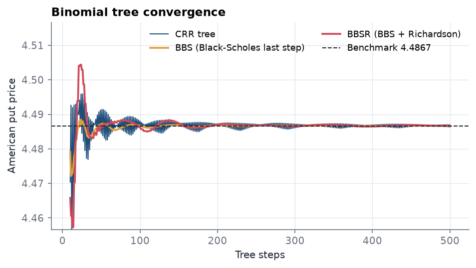

CRR swings between odd and even step counts: about ±0.5¢ at 50 steps and still ±0.04¢ at 500. The smoothed tree (BBS) and its Richardson extrapolation (BBSR) converge without oscillating, and at 500 steps BBSR is within 0.001¢, about 30× closer than CRR.

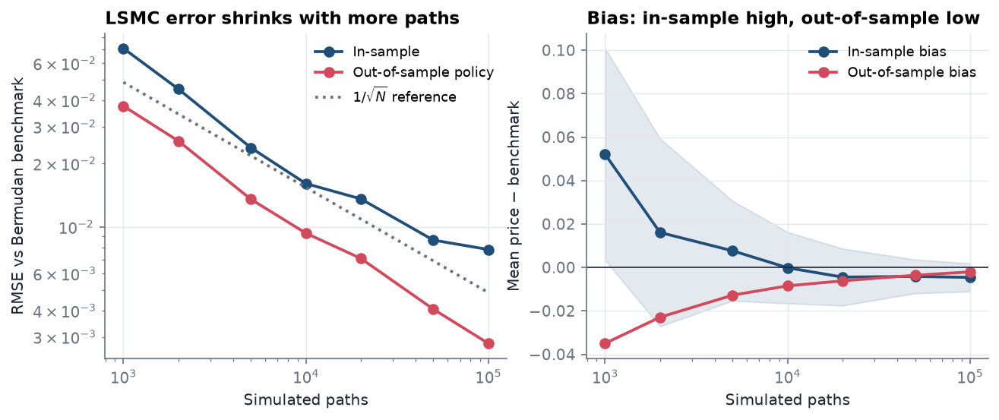

| Paths | Run-to-run sd | In-sample bias | In-sample RMSE | Out-of-sample bias | Out-of-sample RMSE |
|---|---|---|---|---|---|
| 1,000 | 4.88¢ | +5.21¢ | 7.07¢ | −3.50¢ | 3.76¢ |
| 10,000 | 1.64¢ | −0.01¢ | 1.61¢ | −0.85¢ | 0.93¢ |
| 100,000 | 0.65¢ | −0.46¢ | 0.78¢ | −0.20¢ | 0.28¢ |

25 independent runs at each size.

- **Foresight bias at small samples:** the in-sample price is too high (+5.2¢ at 1,000 paths), because the policy is fitted on the same paths it's scored on.
- **Out of sample** the price is always slightly low (a valid lower bound), and its bias shrinks steadily as paths increase.
- **Error falls roughly as 1/√N.**

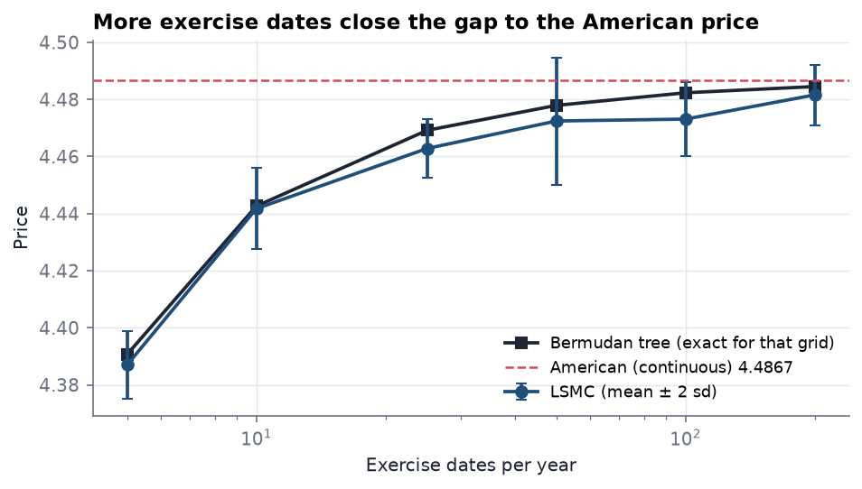

| Exercise dates per year | 5 | 10 | 25 | 50 | 100 | 200 |
|---|---|---|---|---|---|---|
| Bermudan tree | 4.391 | 4.443 | 4.469 | 4.478 | 4.482 | 4.485 |
| LSMC (50k paths) | 4.387 | 4.442 | 4.463 | 4.472 | 4.473 | 4.482 |

The American value is 4.487. Each LSMC price tracks its own Bermudan target, and both converge to the American value as the exercise grid gets finer.

### 3. Basis functions and regression specifications

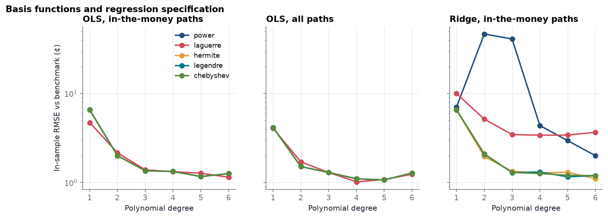

In-sample RMSE vs the benchmark, 10 runs of 20,000 paths each, in cents:

| Spec | Family | Degree 2 | Degree 3 | Degree 4 | Degree 6 |
|---|---|---|---|---|---|
| OLS, in-the-money paths | Laguerre | 2.16 | 1.39 | 1.33 | 1.15 |
| OLS, in-the-money paths | power / Hermite / Legendre / Chebyshev | 2.01 | 1.36 | 1.33 | 1.26 |
| OLS, all paths | Laguerre | 1.71 | 1.30 | **1.02** | 1.24 |
| Ridge, in-the-money paths | Chebyshev / Legendre / Hermite | ~2.0 | ~1.3 | ~1.3 | ~1.2 |
| Ridge, in-the-money paths | Laguerre | 5.16 | 3.46 | 3.40 | 3.67 |
| Ridge, in-the-money paths | power | 46.6 | 40.9 | 4.37 | 2.00 |

- **Degree matters more than family.** Degree 1 is far too crude (4–7¢ RMSE). Error drops sharply up to degree 3, and degrees 3–6 are within noise of each other. Out of sample, the gain stops at degree 3: Laguerre's bias is −0.69¢ at degree 3 and −0.63¢ at degree 6.
- **Under OLS, the polynomial families give identical prices.** At the same degree they describe the same set of functions, so least squares returns the same fit. That's why four of the lines overlap exactly. Only their numerical conditioning differs: the design matrix's condition number at degree 6 is about 46 for Legendre, 56 for Chebyshev, 450 for Hermite, 1.3×10⁷ for power and 9×10¹⁰ for weighted Laguerre. Orthogonal bases are the robust choice at high degree.
- **Ridge breaks that equivalence.** Penalising badly scaled coefficients biases the power and Laguerre fits (up to 47¢), while the well-scaled orthogonal bases are unaffected. Regularisation only helps once the basis is well scaled.
- **Using all paths vs only in-the-money paths** makes little difference here. All paths was slightly better at degree 4 (1.02¢, the best configuration). Longstaff and Schwartz recommend in-the-money paths because those are where the exercise decision is made.

### 4. Variance reduction

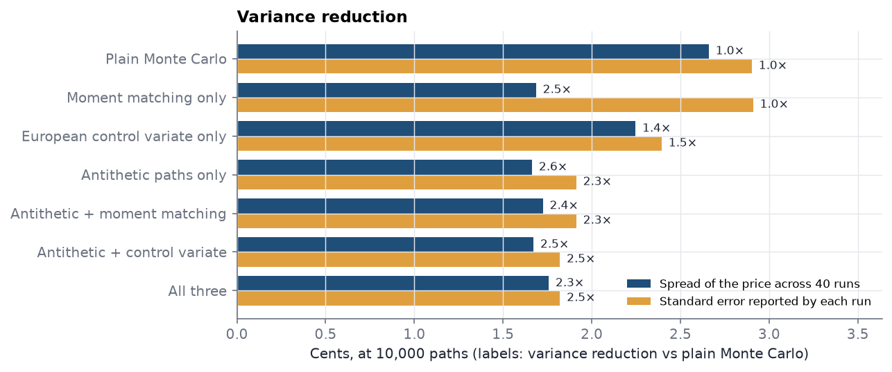

10,000 paths, 40 independent runs each.

| Method | Run-to-run sd | Variance reduction |
|---|---|---|
| Plain Monte Carlo | 2.66¢ | 1.0× |
| Moment matching only | 1.69¢ | 2.5× |
| European control variate only | 2.25¢ | 1.4× |
| Antithetic paths only | 1.66¢ | **2.6×** |
| Antithetic + control variate | 1.67¢ | 2.5× |
| All three | 1.76¢ | 2.3× |

- **Each technique helps on its own, but they don't stack.** Path by path, the American cash flows and the European payoff are correlated at 0.59. After antithetic pairing that correlation is −0.29, because pairing has already removed the variation they share. The noise that remains comes from estimating the exercise policy, which these techniques don't address.
- **Two estimation details matter:**
  - With antithetic paths, the standard error must be computed on pair averages. Treating the pairs as independent hides their benefit entirely.
  - The control-variate coefficient must also be estimated on pairs. Estimated path by path, it *increased* variance.
- **Moment matching has no valid per-run standard error.** It rescales every path together, so they're no longer independent. That's why its reported standard error stays at the plain level while its run-to-run spread falls.

### 5. Machine-learning and RL continuation values

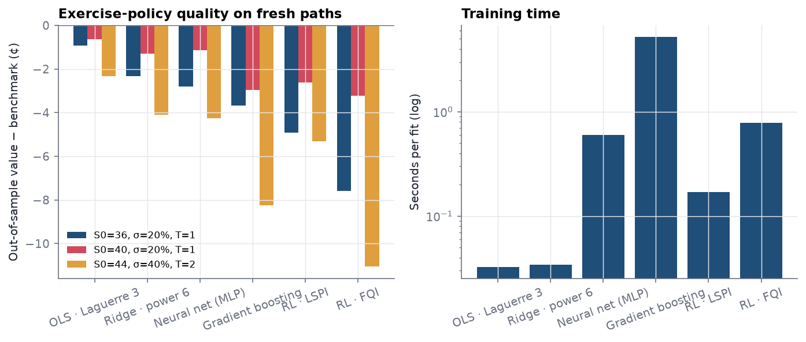

How far each exercise policy's value on 100,000 fresh paths falls below the exact Bermudan price, averaged over 3 training runs of 20,000 paths. Closer to 0 is better.

| Method | S₀=36, σ=20%, T=1 | S₀=40, σ=20%, T=1 | S₀=44, σ=40%, T=2 | Seconds per fit |
|---|---|---|---|---|
| OLS · Laguerre degree 3 | **−0.9¢** | **−0.6¢** | **−2.3¢** | 0.03 |
| Ridge · power degree 6 | −2.3¢ | −1.3¢ | −4.1¢ | 0.03 |
| Neural network (MLP) | −2.8¢ | −1.1¢ | −4.2¢ | 0.6 |
| Gradient boosting (monotone) | −3.7¢ | −3.0¢ | −8.2¢ | 5.2 |
| RL · LSPI | −4.9¢ | −2.6¢ | −5.3¢ | 0.17 |
| RL · FQI | −7.6¢ | −3.2¢ | −11.1¢ | 0.8 |

- **With one state variable, a well-chosen linear basis wins.** It's the most accurate and 20–200× faster. The flexible learners have more variance and no advantage in a smooth one-dimensional problem. Their benefit appears with many state variables, such as basket or path-dependent options, where polynomial bases blow up combinatorially.
- **Gradient boosting overfits** the noisy regression targets. Its in-sample price is 8–19¢ *too high* while its out-of-sample policy is 3–8¢ too low. That's the clearest case for pricing a learned policy on independent paths.
- **The RL methods learn good policies** from one-step transitions, with no backward induction at all: LSPI's is within about 1% of optimal, FQI's within 2%. They're less accurate here because one function has to cover all dates. LSPI beats FQI and needs far fewer iterations: 8 vs about 150.

### 6. The optimal exercise boundary

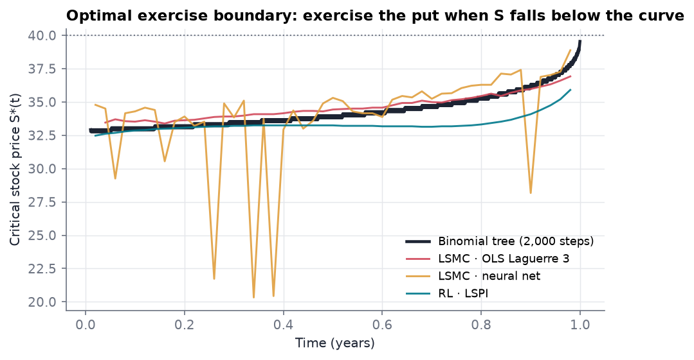

Exercise the put when the stock falls below S\*(t).
- **Tree and least squares:** the boundary rises from about $32.9 a year out to the strike at expiry, and LSMC with least squares tracks the tree closely.
- **LSPI** recovers the shape but stays flat too long.
- **The neural network** is jagged from date to date, because each date's network is a separate noisy fit, even though its prices are close.

### 7. Sensitivity and scenario analysis

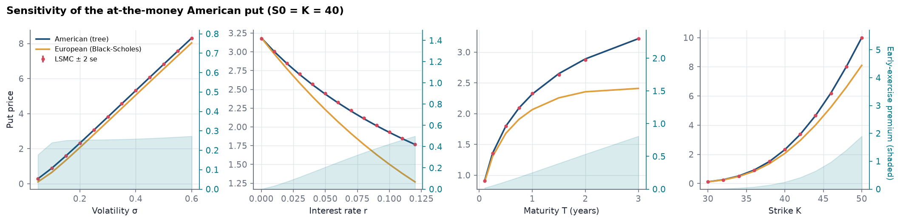

At-the-money put (S₀ = K = 40). Lines are tree and Black-Scholes values, dots are LSMC ± 2 standard errors, and the shaded area is the early-exercise premium.

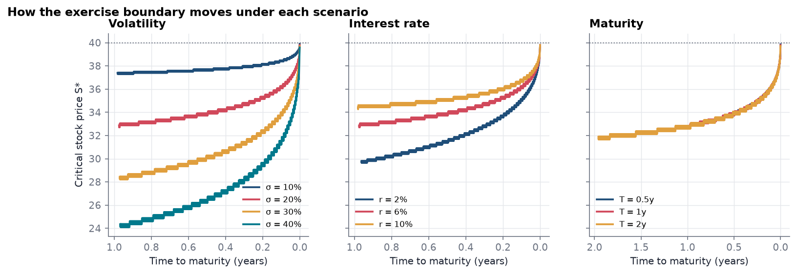

- **Volatility** pushes the boundary *down*: from S\* ≈ 37.4 at σ = 10% to 24.4 at σ = 40%. More volatility makes waiting more valuable.
- **Interest rates** push it *up*. Receiving K sooner earns more interest, so exercise comes earlier.
- **Maturity:** the boundary depends only on *time remaining*. The 6-month, 1-year and 2-year curves sit on top of each other.

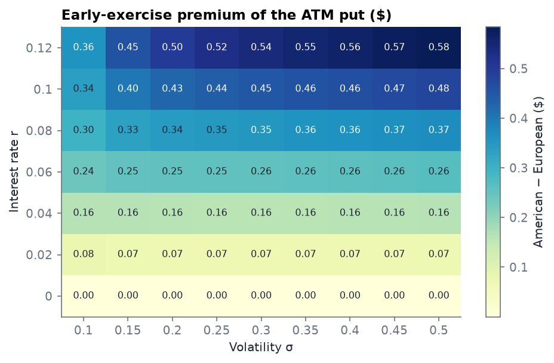
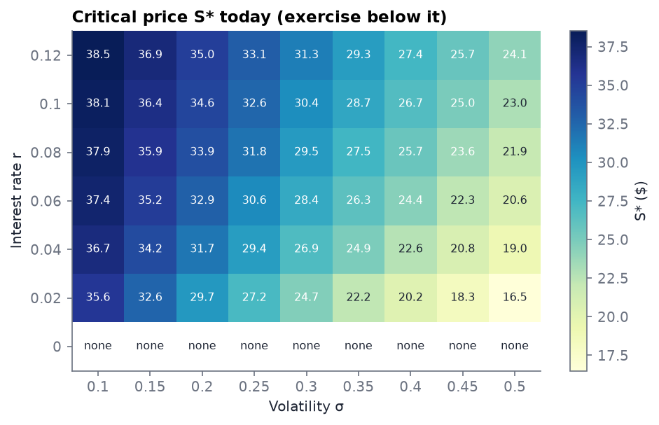

- **The early-exercise premium is driven by rates.** It's zero at r = 0, where an American put without dividends is never exercised early, and $0.58 at r = 12%, σ = 50%. Volatility matters much less.
- **The critical price today** falls with volatility and rises with rates. There's no exercise region at all when r = 0.

Stress scenarios (at-the-money base: σ 20%, r 6%, 1 year):

| Scenario | American | European | Early-exercise premium | Critical price S\* today | LSMC |
|---|---|---|---|---|---|
| Base | 2.320 | 2.066 | 0.253 (10.9%) | 32.87 | 2.329 |
| Volatility +50% (σ 30%) | 3.812 | 3.557 | 0.255 (6.7%) | 28.45 | 3.823 |
| Volatility −50% (σ 10%) | 0.894 | 0.654 | 0.240 (26.8%) | 37.40 | 0.899 |
| Rates +300bp (r 9%) | 2.015 | 1.630 | 0.385 (19.1%) | 34.26 | 2.022 |
| Rates to zero | 3.186 | 3.186 | 0.000 (0%) | none | 3.173 |
| Short maturity (3 months) | 1.357 | 1.303 | 0.053 (3.9%) | 35.07 | 1.354 |
| Long maturity (3 years) | 3.219 | 2.410 | 0.809 (25.1%) | 31.42 | 3.217 |
| Deep in the money (K 48) | 8.012 | 6.608 | 1.404 (17.5%) | 39.59 | 8.000 |
| Out of the money (K 34) | 0.515 | 0.477 | 0.038 (7.4%) | 28.01 | 0.508 |
| Dividend yield 3% | 2.648 | 2.507 | 0.141 (5.3%) | 31.38 | 2.657 |

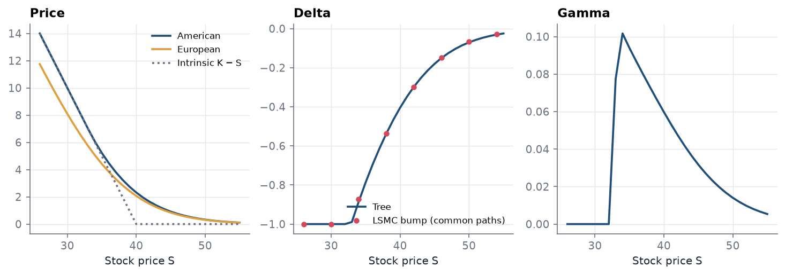

Tree delta and gamma across the stock price. LSMC delta, computed by bumping S₀ with the same simulated paths (common random numbers), matches the tree to within 0.013 everywhere.

---

## Usage

```bash
git clone https://github.com/cwford06/american-options-lsmc.git
cd american-options-lsmc
python3 -m venv .venv && source .venv/bin/activate
pip install -r requirements.txt

pytest -q                               # 25 tests
python -m amerop.experiments            # all experiments, about 4 minutes
python -m amerop.experiments --quick    # smoke test, about 30 seconds
```

```python
import numpy as np
from amerop import OptionSpec, bbsr, bermudan_tree, bs_price, lsmc, LSMCConfig, lspi, simulate_gbm, evaluate_policy

put = OptionSpec(S0=36, K=40, r=0.06, sigma=0.2, T=1.0)
bbsr(put)                          # 4.4867  American benchmark
bermudan_tree(put, 50)             # 4.4779  50 exercise dates
bs_price(put)                      # 3.8443  European

res = lsmc(put, LSMCConfig(n_paths=100_000, basis="laguerre", degree=3))
res.price, res.stderr              # (4.478, 0.006)

fresh = simulate_gbm(put, 100_000, 50, np.random.default_rng(1))
evaluate_policy(put, res.continuation, fresh)       # learned policy on new paths

rl = lspi(put, simulate_gbm(put, 50_000, 50, np.random.default_rng(2)))
evaluate_policy(put, rl.continuation, fresh)
```

## Layout

```
amerop/
  models.py               contract spec, Black-Scholes, risk-neutral GBM simulation
  binomial.py             CRR tree, BBSR benchmark, Bermudan tree, boundary and Greeks
  basis.py                power, Laguerre, Hermite, Legendre and Chebyshev bases
  longstaff_schwartz.py   LSMC with OLS, ridge, MLP and gradient-boosting estimators; policy evaluation; boundary
  rl.py                   LSPI and Fitted Q-Iteration
  experiments.py          every study in this README
  plots.py                figures
tests/                    25 tests: tree vs Black-Scholes, parity, published values, LSMC vs Bermudan, RL convergence
results/                  CSV output of every experiment, plus summary.json
figures/                  PNG charts
```

## References

- Longstaff, F. A. & Schwartz, E. S. (2001). Valuing American options by simulation: a simple least-squares approach. *Review of Financial Studies* 14(1).
- Cox, J. C., Ross, S. A. & Rubinstein, M. (1979). Option pricing: a simplified approach. *Journal of Financial Economics* 7(3).
- Broadie, M. & Detemple, J. (1996). American option valuation: new bounds, approximations, and a comparison of existing methods. *Review of Financial Studies* 9(4).
- Li, Y., Szepesvári, C. & Schuurmans, D. (2009). Learning exercise policies for American options. *AISTATS*.
- Lagoudakis, M. G. & Parr, R. (2003). Least-squares policy iteration. *JMLR* 4.
- Glasserman, P. (2004). *Monte Carlo Methods in Financial Engineering*. Springer.

## License

MIT
